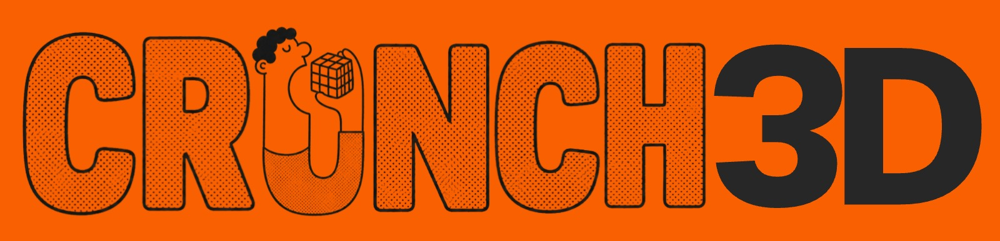
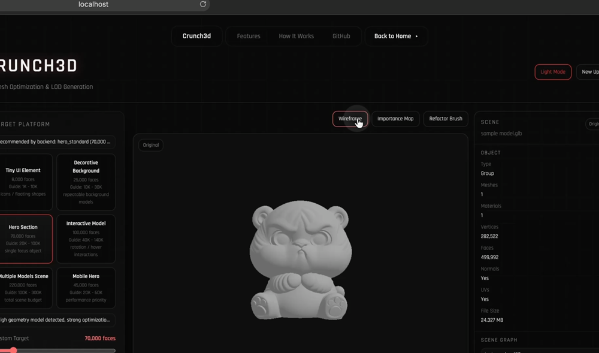
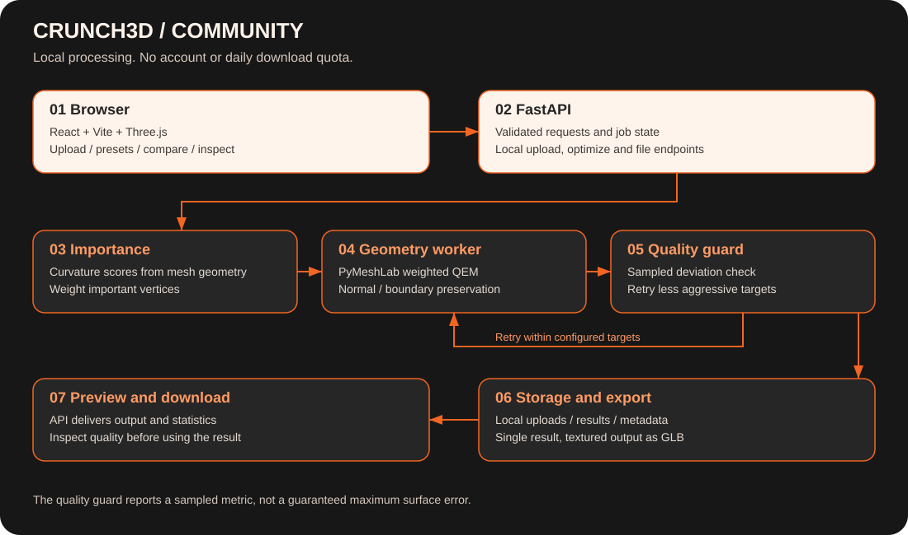

<a id="readme-top"></a>

<div align="center">
  
  <h1>Crunch3D</h1>
  <p>Fewer polygons. More room to build.</p>
  <p>
    <a href="#demo">Watch demo</a> ·
    <a href="#getting-started">Get started</a> ·
    <a href="#system-architecture">Architecture</a> ·
    <a href="#team">Meet the team</a>
  </p>
</div>

<p align="center">
  <a href="./LICENSE"></a>
  <a href="https://github.com/Lesgo-HQ/Crunch3D/stargazers"></a>
  <a href="https://github.com/Lesgo-HQ/Crunch3D/forks"></a>
  <a href="https://github.com/Lesgo-HQ/Crunch3D/issues"></a>
</p>

## Demo

See Crunch3D in action. Click the preview to open the demo video.

[](https://github.com/Lesgo-HQ/Crunch3D/blob/main/assets/branding/crunch3d-demo.mp4)

[Watch the demo](https://github.com/Lesgo-HQ/Crunch3D/blob/main/assets/branding/crunch3d-demo.mp4) · [Download the video](https://raw.githubusercontent.com/Lesgo-HQ/Crunch3D/main/assets/branding/crunch3d-demo.mp4)

The recording shows an earlier interface, including controls that are not available in this release. The feature list below describes what this repository supports.

<details>
  <summary>Table of contents</summary>
  <ol>
    <li><a href="#about-the-project">About the project</a></li>
    <li><a href="#built-with">Built with</a></li>
    <li><a href="#system-architecture">System architecture</a></li>
    <li><a href="#getting-started">Getting started</a></li>
    <li><a href="#usage">Usage and local API</a></li>
    <li><a href="#limitations">Limitations</a></li>
    <li><a href="#contributing">Contributing</a></li>
    <li><a href="#repository-activity">Repository activity</a></li>
    <li><a href="#team">Team</a></li>
    <li><a href="#license">License</a></li>
    <li><a href="#contact">Contact</a></li>
  </ol>
</details>

## About the project

A mesh can look great and still be too heavy for a game, a website, or a real-time scene. Crunch3D helps you reduce that weight, inspect what changed, and decide whether the result is right for your project.

Crunch3D runs on your own machine. You bring the mesh, choose a face budget, and get a single optimized result. No account, watermark, daily download limit, or background training on your files.

### What you can do

- **Reduce polygon counts** with curvature-weighted quadric error metric (QEM) decimation.
- **Protect useful detail** with normal and boundary preservation options.
- **Check the result** with a sampled quality guard that retries less aggressive targets and reports whether the requested threshold was met.
- **Compare before and after** in the 3D viewer, with wireframe, curvature heatmap, mesh inspection, and file statistics.
- **Choose a starting point** from six presets, or set your own face target.
- **Export locally** with basic UV and material handling. Textured results use self-contained GLB output.
- **Use the local API** to fit the optimizer into your own workflow.

### Built with

<p align="center">
  
  
  
  
  
  
  
  
</p>

| Layer | Tools | What they do |
| :--- | :--- | :--- |
| Interface | React, JavaScript, Vite, Tailwind CSS | Uploads, controls, statistics, and the local app shell |
| 3D preview | Three.js, React Three Fiber, Drei | Before/after rendering, camera controls, and inspection |
| API | Python, FastAPI, Pydantic, Uvicorn | Request validation, job state, and file endpoints |
| Geometry | PyMeshLab, Trimesh, NumPy, SciPy | Mesh loading, curvature scores, QEM, and sampled quality checks |
| Images | Pillow | Texture image handling |
| Development | pnpm, pytest, HTTPX, Docker | Dependency management, small automated checks, and a backend container |

### System architecture



1. The browser sends a mesh to the local FastAPI server.
2. The server validates the upload and stores its files and job metadata locally.
3. Optimization runs in a separate process. Curvature scores weight the QEM simplifier; quality checks can retry with a higher face target.
4. The API returns statistics, a preview, and the downloadable result to the same browser.

The browser, API, worker, and files all live on your computer. The browser talks to `127.0.0.1:8000` through Vite’s local proxy; there is no remote processing service in this architecture.

```text
Crunch3D/
├── assets/              # Brand images and architecture diagram
├── model/
│   ├── api/             # Local endpoints and request schemas
│   ├── engine/          # QEM optimization and quality guard
│   ├── importance/      # Curvature-only importance scores
│   ├── services/        # Local file handling and mesh analysis
│   └── tests/           # Small synthetic-mesh and API checks
└── web/src/             # Local optimizer interface and 3D viewer
```

## Getting started

### Prerequisites

- Python **3.11**
- Node.js **18+** and **pnpm**
- On Linux, the OpenGL system libraries needed by PyMeshLab. The supplied Dockerfiles include them.

### Installation and execution

```sh
git clone https://github.com/Lesgo-HQ/Crunch3D.git
cd Crunch3D
python3.11 -m venv .venv
source .venv/bin/activate
pip install -r model/requirements.txt
cp .env.example .env
uvicorn model.main:app --host 127.0.0.1 --port 8000
```

On Windows, activate the environment with `.venv\Scripts\activate` instead.

In another terminal:

```sh
cd Crunch3D/web
pnpm install --frozen-lockfile
pnpm dev
```

Open **http://localhost:5173**. Vite forwards `/api` requests to the backend on port 8000. API documentation is available at **http://localhost:8000/docs**.

### Configuration and local files

| Setting | Default | Purpose |
| :--- | :--- | :--- |
| `MAX_FILE_SIZE_MB` | `0` (unlimited) | Optional local upload cap in MB. Leave at `0` for no application size limit |
| `CORS_ORIGINS` | Localhost ports 5173 and 3000 | Browser origins allowed to call the API |
| `VITE_API_BASE_URL` | Same-origin `/api` | Optional frontend override in `web/.env.local` |

Uploads and results live in `model/uploads/` and `model/processed/`. They stay there until you delete them, and Git ignores both folders. `DELETE /api/job/{job_id}` removes a job and its files.

There is no default file-size cap. Available RAM, disk space, and processing time still determine what your machine can handle. Set a positive `MAX_FILE_SIZE_MB` only if you want a local safeguard.

Keep the backend bound to localhost. Crunch3D does not include multi-user authentication or tenant isolation.

## Usage

1. Open the local app and upload a static mesh.
2. Pick a preset or move the custom face-count slider.
3. Choose preservation options and a quality threshold, then select **Optimize Mesh**.
4. Inspect the original and result. Read the quality report before exporting.
5. Download the result, or adjust the target and try again.

### Local API

| Method | Endpoint | Purpose |
| :--- | :--- | :--- |
| `POST` | `/api/upload` | Upload and inspect a mesh |
| `POST` | `/api/optimize` | Optimize a job with a target and preservation settings |
| `GET` | `/api/status/{job_id}` | Read job state |
| `GET` | `/api/importance/{job_id}` | Read curvature importance scores |
| `GET` | `/api/preview/{job_id}` | Preview the output mesh |
| `GET` | `/api/download/{job_id}` | Download the result without a daily quota |
| `DELETE` | `/api/job/{job_id}` | Remove local job files |
| `GET` | `/health` | Check backend health |

The upload response includes the `job_id` used by the other endpoints. The schema at `/docs` is the source of truth for request fields. Unknown optimization options are rejected.

### Development checks

```sh
pip install -r model/requirements-dev.txt
python -m pytest model/tests -q
pnpm --dir web build
```

The tests use tiny generated meshes. You do not need a large model collection to contribute.

## Limitations

- **Static meshes:** rigging and animations are not preserved.
- **Input support:** OBJ, STL, PLY, GLB, GLTF, FBX, and OFF are accepted, subject to loader support. OFF has no original browser preview; FBX depends on the available loader.
- **Textures:** prefer self-contained GLB. Uploading external GLTF buffers or OBJ texture sidecars together is not supported. Multi-material exports can lose detail.
- **Quality measurement:** the guard uses sampled nearest-vertex distances. It is not a guarantee of maximum surface error and can report a failed threshold after retries.
- **Heatmap alignment:** file loaders can reorder vertices, so the displayed curvature heatmap is approximate.

## Contributing

Found a mesh that behaves unexpectedly? Open an issue with the file format, target count, preservation settings, and a small reproduction you have permission to share. Include the error message and your Python and operating-system versions.

Start with the [contribution guide](CONTRIBUTING.md) for setup, checks, review, and licensing expectations. Please discuss large algorithm or format changes in an issue first.

[Code of conduct](CODE_OF_CONDUCT.md) · [Security policy](SECURITY.md) · [Get help](SUPPORT.md) · [Maintainers](MAINTAINERS.md)

## Repository activity

These badges read live repository data. Their values reflect this repository, including its fresh history, rather than earlier development elsewhere.

<p>
  <a href="https://github.com/Lesgo-HQ/Crunch3D/commits/main/"></a>
  <a href="https://github.com/Lesgo-HQ/Crunch3D/activity"></a>
  <a href="https://github.com/Lesgo-HQ/Crunch3D/pulls"></a>
</p>

[Browse activity](https://github.com/Lesgo-HQ/Crunch3D/activity) · [Report an issue](https://github.com/Lesgo-HQ/Crunch3D/issues) · [Star the project](https://github.com/Lesgo-HQ/Crunch3D/stargazers)

## Team

Crunch3D is built and maintained by these four contributors. The small profile links below are our core team. New contributors appear in the contribution gallery as their commits are credited on GitHub.

<p>
  <a href="https://github.com/anish-9387" title="anish-9387"></a>
  <a href="https://github.com/itzsouravkumar" title="itzsouravkumar"></a>
  <a href="https://github.com/aashisoni000" title="aashisoni000"></a>
  <a href="https://github.com/itzayush18" title="itzayush18"></a>
</p>

### Everyone who contributes

<a href="https://github.com/Lesgo-HQ/Crunch3D/graphs/contributors">
  
</a>

The gallery is generated from GitHub contribution data by [contrib.rocks](https://contrib.rocks). It refreshes automatically, subject to service caching. [See all contributors](https://github.com/Lesgo-HQ/Crunch3D/graphs/contributors).


## License

Crunch3D's original code and documentation are licensed under **GNU General Public License v3.0**. You can use, study, modify, and redistribute the software, including commercially, under its terms. Covered distributed modifications must remain under GPLv3, with the required corresponding source. There is no warranty.

Read the full [license](LICENSE), [copyright and asset exceptions](COPYRIGHT.md), and [third-party dependency notices](THIRD_PARTY_NOTICES.md). Contributors retain copyright to their work. Processing a mesh does not automatically place that mesh or its output under GPL.

## Contact

For bugs and feature requests, use [GitHub Issues](https://github.com/Lesgo-HQ/Crunch3D/issues). For project questions, reach out through one of the team profiles above or visit [Lesgo-HQ](https://github.com/Lesgo-HQ).

<p align="right"><a href="#readme-top">Back to top</a></p>
